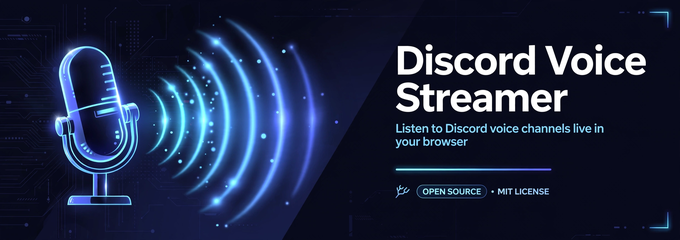
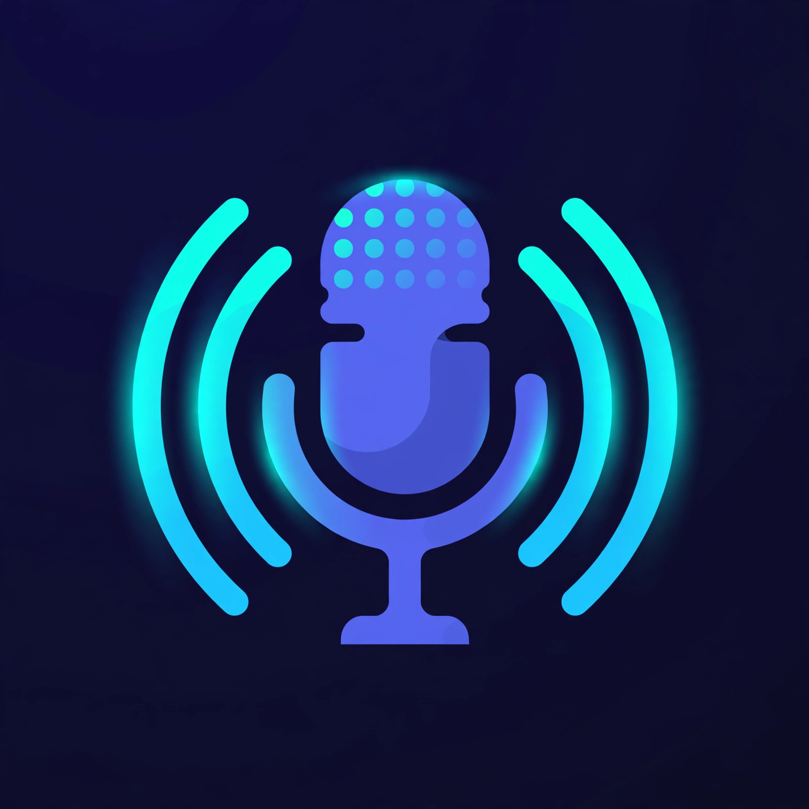
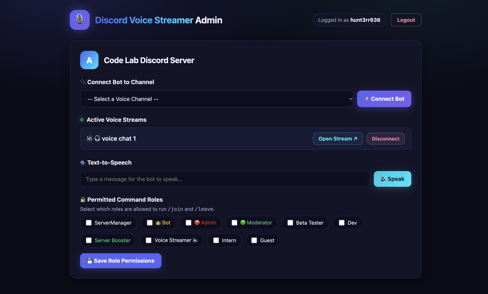
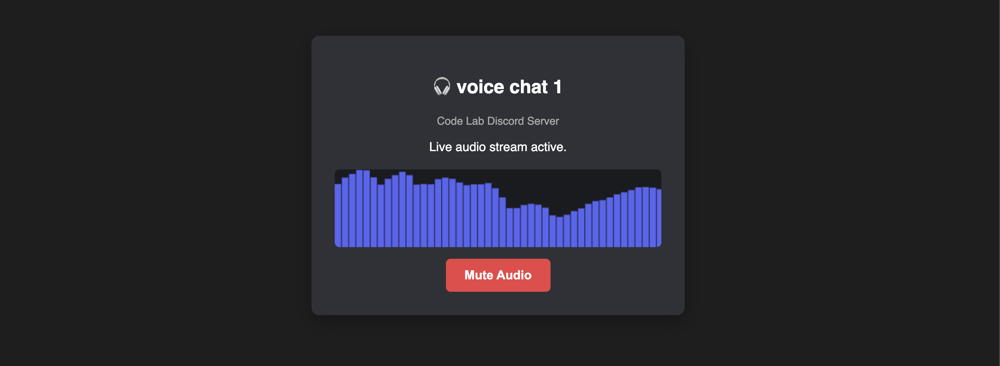

<p align="center">
  
</p>

<p align="center">
  
</p>

# 🎙️ Discord Voice Streamer

[](https://github.com/nishadnyc/Discord-Voice-Channel-Streamer-Bot/actions)
[](https://nodejs.org)
[](#-option-a--docker-recommended)
[](https://discord.com/developers/applications)
[](LICENSE)

**Discord Voice Streamer** is a free, open-source, self-hosted Discord bot that streams voice channel audio **live to the web**. Invite the bot to your server, run `/join` in a voice channel, and share the link — anyone can listen live in their browser, no Discord account needed. Talk back into the channel with built-in text-to-speech (TTS), manage everything from a secure admin panel, and run it anywhere with Docker.

> 🌐 **Project website:** https://nishadnyc.github.io/Discord-Voice-Channel-Streamer-Bot/

<p>
  
  
  
</p>

## ✨ What it does

- 🔊 **Live listening** — the bot joins a voice channel and streams the audio to a web page you can open anywhere
- 🗣️ **Text-to-speech** — type a message in the admin panel or with `/tts` and the bot speaks it into the channel
- 🖥️ **Admin panel** — secure Discord login, join/leave channels, manage per-server settings
- ⚡ **Slash commands** — `/join`, `/leave`, `/tts` right from Discord
- 🔁 **Stays running** — built to run 24/7; server settings survive restarts

No privileged Discord intents required.

---

## 📸 Screenshots




---

## ✅ Prerequisites

1. A Discord application with a bot ([Discord Developer Portal](https://discord.com/developers/applications))
   - Copy the **bot token** (Bot tab → Reset Token)
   - Copy the **client ID** and **client secret** (OAuth2 tab)
   - No privileged intents need to be enabled
2. Your bot invited to your server ([invite guide](#-invite-the-bot-to-your-server))
3. Docker **or** Node.js 22+ (see setup options below)
   - If you choose Docker, make sure it is installed and running: [Get Docker](https://docs.docker.com/get-docker/)

---

## 🐳 Option A — Docker (recommended)

The image ships with everything the bot needs, including ffmpeg for text-to-speech.

```bash
git clone https://github.com/nishadnyc/Discord-Voice-Channel-Streamer-Bot.git
cd Discord-Voice-Channel-Streamer-Bot

cp .env.example .env
# ✏️ Fill in your values (see Configuration below)

docker compose up --build -d
```

On startup the bot prints your **OAuth redirect URI** — copy it into your Discord application's **OAuth2 → Redirects** list:

```
OAuth redirect URI (register this in the Discord Developer Portal): https://your-domain:36363/auth/discord/callback
```

Then open the admin panel at `https://your-domain:36363/admin` and log in with Discord. 🎉

> 💾 Your server settings live in `server_configs.json`, which is mounted into the container — they survive restarts and redeploys.

---

## 🟢 Option B — Node.js (manual)

For development or if you prefer running without Docker.

**Prerequisites:** Node.js 22+ and [ffmpeg](https://ffmpeg.org/download.html) installed.

```bash
git clone https://github.com/nishadnyc/Discord-Voice-Channel-Streamer-Bot.git
cd Discord-Voice-Channel-Streamer-Bot

npm install

cp .env.example .env
# ✏️ Fill in your values (see Configuration below)

npm start
```

Same as above: copy the OAuth redirect URI from the startup log into your Discord application's **OAuth2 → Redirects** list, then open `/admin` and log in. 🎉

---

## ⚙️ Configuration

All settings come from the `.env` file:

| Variable                | Required | What it is                                                   |
| ----------------------- | -------- | ------------------------------------------------------------ |
| `DISCORD_TOKEN`         | ✅       | Your bot's token (Developer Portal → Bot)                    |
| `CLIENT_ID`             | ✅       | Your application's client ID (Developer Portal → OAuth2)     |
| `DISCORD_CLIENT_SECRET` | ✅       | Your application's client secret (Developer Portal → OAuth2) |
| `SESSION_SECRET`        | ✅       | A long random string for admin login sessions                |
| `APP_DOMAIN`            | ✅       | Your public URL, e.g. `https://your-domain`                  |
| `PORT`                  | ✅       | Port the app listens on, e.g. `36363`                        |
| `PUBLIC_URL`              | Optional  | Full public base URL. Set this when behind a reverse proxy/tunnel where the public URL differs from `APP_DOMAIN`:`PORT` — fixes stream links, the OAuth callback, and the startup log line at once |
| `TITLE`                 | Optional        | Dashboard title shown on all web pages and the `/help` embed (default `Discord Voice Streamer`) |
| `DEBUG`                 | Optional        | Verbose emoji/color logging; `false` silences debug output (default `true`)  |

The app refuses to start if any required variable is missing, and tells you exactly which one.

---

## 🔗 The OAuth callback URL

Discord only sends logins to redirect URLs you've whitelisted. The URL is:

```
{APP_DOMAIN}:{PORT}/auth/discord/callback
```

(The port is omitted when it's 80 or 443.) You don't have to assemble this yourself — **the app prints the exact URL on every startup**. Paste it verbatim into **OAuth2 → Redirects** in the Developer Portal and hit Save.

### Optional: behind a reverse proxy or tunnel

If the app sits behind a reverse proxy or a tunnel (e.g. Cloudflare Tunnel, ngrok), the public URL your users see can differ from the app's own `APP_DOMAIN`:`PORT`. For example, the app listens on port `36363` internally, but the tunnel serves it publicly on standard HTTPS with no visible port:

- ❌ Without `PUBLIC_URL`: stream links and the login callback point to `https://your-domain.com:36363/...` — a dead URL, since that port isn't publicly reachable.
- ✅ With `PUBLIC_URL=https://your-domain.com`: stream links, the OAuth callback URL, and the "Server running at" log line all use the clean public URL.

```env
PUBLIC_URL=https://your-domain.com
```

Register the callback URL the app prints on startup in **OAuth2 → Redirects**. Not using a proxy or tunnel? Skip this — everything is built from `APP_DOMAIN` and `PORT` automatically.

---

## 🤖 Invite the bot to your server

1. In the Developer Portal, go to **OAuth2 → URL Generator**
2. Select scopes: `bot` and `applications.commands`
3. Select permissions: **Connect**, **Speak**, **Send Messages**
4. Open the generated URL and invite the bot to your server

---

## 🩺 Troubleshooting

| Problem                                  | Fix                                                                                                                 |
| ---------------------------------------- | ------------------------------------------------------------------------------------------------------------------- |
| Bot won't join a voice channel           | Check it has the **Connect** and **Speak** permissions in that channel                                              |
| Admin login fails / `redirect_uri` error | The redirect URL in the Developer Portal must match the startup log **exactly** — including `https` and the port    |
| Port already in use                      | Change `PORT` in `.env` (and update the redirect URL to match)                                                      |
| No audio on the web page                 | Make sure someone is actually speaking in the channel, and that the bot finished joining before you opened the page |

---

## 🔒 Security notes

- **Stream links are public to anyone with the URL.** The `/channel/:channelId` pages don't require a login — treat a stream link like an unlisted video URL and only share it with people you trust.
- **The admin panel is login-gated.** Every `/admin` and `/api/admin/*` route requires Discord OAuth, and only members with Administrator / Manage Server (or roles you configure) in that server can control the bot.
- **Keep your `.env` private.** It holds your bot token and OAuth client secret — never commit it (it's gitignored).
- **Set a strong `SESSION_SECRET`.** The app refuses to start without one.

---

## 📄 License

MIT — see [LICENSE](LICENSE).
